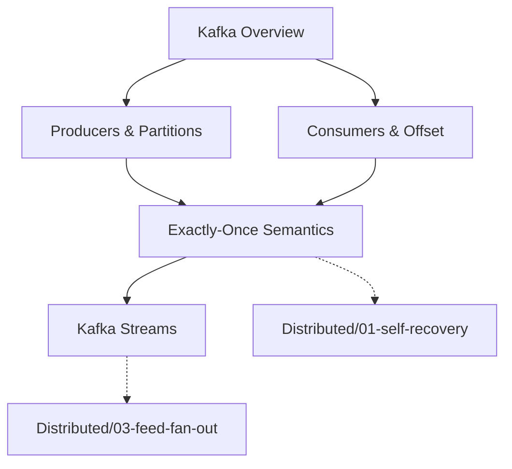

# Create Learning Loop Lesson

Create factual, trade-off-aware lessons for the **Learning Loop App** — a static learning platform built on the Learning Loop pedagogy. Lessons are written in Obsidian-flavored Markdown with code blocks, answer reveal, quiz integration, and progress tracking.

## When This Skill Triggers

Use this skill when the user asks to create one or more lessons. Key trigger phrases:
- "create lessons [topics] for learning loop app"
- "write a lesson about [topic]"
- "add [topic] to the course"
- "create a learning loop lesson"
- Any request referencing the learning-loop-app lesson format

---

## Core Philosophy — Write Like an Engineer, Not a Salesperson

These principles are **non-negotiable**. Every section of every lesson must follow them:

### 1. Facts Over Claims
- State **what is true**, not what sounds impressive
- Every technical claim must be **verifiable** — cite the source: official docs, RFCs, engineering blogs, production data, benchmark results
- If you cannot verify it, say so explicitly: "ในทางทฤษฎี..." or "จากประสบการณ์จริงของทีม X..."
- Reference format: inline `[source: official docs]` or footnote-style `> **อ้างอิง:** [PostgreSQL docs — MVCC](https://...)`

### 2. No Tool Worship — No "God Tool"
- **There is no perfect tool.** Every choice is a trade-off.
- Never write "X is the best solution for Y" — write "X solves Y **when** [conditions], **but** sacrifices [trade-off]"
- Never imply a single tool solves everything. Show **2-3 alternatives** with their own trade-offs
- Language like "just use Redis" is banned. Replace with "Redis fits **if** your access pattern is [X], **but** consider [Y] if you need [Z]"

### 3. Problem → Tool, Not Tool → Problem
- Always start from the **problem and constraints**, then show what tools **could** address it
- Never start by introducing a tool and then looking for problems it solves
- Structure: "เมื่อคุณเจอปัญหา X ภายใต้เงื่อนไข Y → เครื่องมือเหล่านี้เป็นตัวเลือก → แต่ละตัวมี trade-off ต่างกัน"

### 4. Context-Driven Decision Making
- Every recommendation must include the **context** it was made in: goals, constraints, scale, team size, budget, timeline
- What works at 1K req/s may fail at 1M req/s. What works for a 3-person team may not work for 50
- Always show **decision boundaries**: "Use X when [A], avoid X when [B]"

### 5. Show the Cost, Not Just the Benefit
- Every feature explained must include what you **give up** or **risk**
- "Redis gives sub-ms reads" → add "**but** you now manage cache invalidation, memory limits, and consistency with your source of truth"
- Every code example should include a comment about its **limitation or assumption**

### Banned Patterns ❌

| Banned | Replace With |
|---|---|
| "X is the industry standard" | "X is widely adopted **because** [specific reason with source]" |
| "X is the best choice" | "X is a strong choice **when** [conditions], **but** [trade-off]" |
| "Just use X" | "X solves [specific problem] at the cost of [specific trade-off]" |
| "X solves everything" | "X addresses [scope], **but does not cover** [scope]" |
| "X is simple/easy" | "X has [specific complexity] that you need to handle: [list]" |
| Vendor marketing language | Factual description of capability + limitation |
| Unsupported performance claims | Benchmarked data with source, or "generally observed" with caveat |

---

## Lesson Content Types

The Learning Loop App supports multiple content types. Each lesson declares its `contentType` in YAML frontmatter. Choose the right type based on the lesson's purpose:

| Content Type | Frontmatter Value | Description | Required Sections |
|---|---|---|---|
| **Learning Loop** | `learning-loop` | Standard 7-stage interactive lesson (default) | orient → attempt → feedback → explain → extend → checkpoint → reflect |
| **Overview** | `overview` | Series overview/roadmap with lesson listing | orient → roadmap → lesson list |
| **Deep Dive** | `deep-dive` | Long-form technical article (no quiz cycle) | orient → explain → extend → checkpoint → reflect |
| **Cheatsheet** | `cheatsheet` | Quick reference card (tables, commands, patterns) | orient → commands → patterns → checkpoint |
| **Case Study** | `case-study` | Real-world production incident analysis | orient → scenario → timeline → analysis → reflect |
| **Interactive Lab** | `interactive-lab` | Hands-on lab with code exercises | orient → exercise → solution → checkpoint → reflect |

### Content Type Selection Guide

- **Default to `learning-loop`** — this is the primary pedagogy for most lessons
- Use **`overview`** for `00-overview.md` files in section directories
- Use **`deep-dive`** when the topic is too complex for a single attempt/feedback cycle
- Use **`cheatsheet`** for quick-reference lessons (CLI commands, API reference, config snippets)
- Use **`case-study`** for real-world incident post-mortems
- Use **`interactive-lab`** for hands-on coding exercises

## The Learning Loop Pattern (Default: `learning-loop`)

Every lesson follows a 7-stage progression (plus intro and related topics). The flow is designed for self-paced, interactive learning — the learner attempts before seeing the answer, checks understanding at a checkpoint, and reflects at the end.

### Required Sections (in order)

```
# [Thai Title] ([English Title])

[YAML frontmatter with metadata]

---

## 🎯 ปฐมนิเทศ (Orient)

## 🧪 ลองทำก่อน (Attempt)

## 💬 ผลตอบรับ (Feedback)

## 📖 คำอธิบาย (Explain)

## 🔬 ขยายความ (Extend)

## ✅ จุดตรวจสอบ (Checkpoint)

## 🤔 สะท้อนคิด (Reflect)

## 📚 หัวข้อที่เกี่ยวข้อง (Related Topics)
```

For **overview** lessons (`contentType: overview`), use `🗺️` and `📋` sections instead of the attempt/feedback pair.

### Section Content Guidelines

#### 🎯 Orient — Set the Context (2-4 sentences)

Frame the **problem space**, not the solution. Explain what real-world problem this topic addresses and why it matters. Be factual.

**Good openings — start from the problem:**
- A specific production constraint ("เมื่อระบบต้องรองรับ 10K concurrent connections ด้วย budget จำกัด...")
- A real engineering trade-off ("ทุกตัวเลือกมี cost — เลือกอะไรก็แลกอะไร...")
- A concrete failure mode ("เมื่อ single DB node ไม่พอ — จะแบ่งข้อมูลยังไงโดยไม่พัง...")

**Avoid — sales/marketing language:**
- ❌ "Redis is the most popular caching solution..."
- ❌ "In this lesson you'll master the amazing world of..."
- ❌ "X is the go-to solution for..."

The orient section should make the learner think "อ๋อ ปัญหานี้แหละที่ผมเจอ" — not "เครื่องมือนี้เก่งจัง"

#### 🧪 Attempt — The Challenge (scenario + question)

Present a **realistic, production-grade scenario** with specific numbers and constraints. This is NOT a toy example — it should feel like a real design decision an engineer faces, with competing constraints that force a trade-off.

Structure:
1. **สถานการณ์ (Scenario):** 2-4 sentences with concrete details (traffic, data sizes, SLA, budget, team size, time constraints)
2. **ข้อจำกัด (Constraints):** What the engineer CANNOT do (no infinite budget, no magic scaling, must maintain X)
3. **คำถาม (Question):** 1-2 specific questions that have **no single right answer** — the quality of the answer depends on how well the learner considers trade-offs
4. **✋ Stop prompt:** "หยุดตรงนี้ก่อน" — instruct them to pause and think before scrolling

Make scenarios context-rich and include **competing constraints** that prevent a trivial answer:
- "ต้องตอบใน < 100ms **แต่** data size 50TB"
- "ต้อง consistent **แต่** multi-region"
- "ต้อง real-time **แต่** budget จำกัด"

##### 🎭 Trap Crafting — Make Answers Hard to Guess

The options table in Feedback must be designed so that **only someone with real, deep knowledge can identify the correct answer**. Every option should feel plausible on the surface — a novice should hesitate and second-guess themselves.

**Anti-patterns to avoid:**
- ❌ One obviously-wrong joke answer ("just add more RAM lol")
- ❌ One absurdly oversimplified answer ("ใช้ Round Robin ก็พอ" for a consistency problem)
- ❌ Correct answer that stands out because it's the only one mentioning a specific trade-off
- ❌ Straw-man wrong answers that no real engineer would actually give

**How to craft genuine traps:**
1. **Every wrong answer must sound like legitimate advice** a mid-level engineer might actually give — cite a pattern, tool, or approach that solves *some* problem, just not *this* problem under *these* constraints
2. **Plausible but incomplete** — wrong answers solve 80% of the problem but fail on the critical constraint (e.g., "ใช้ Redis Cache" sounds right until you notice the data is 50TB and mostly cold)
3. **Right tool, wrong context** — the tool/pattern is valid for a *different* scenario. The learner must recognize that context boundaries matter (e.g., "ใช้ event sourcing" is great for audit trails but overkill for a simple counter)
4. **Correct diagnosis, wrong fix** — the answer correctly identifies the symptom (e.g., "database is slow") but proposes the wrong remedy (e.g., "add more indexes" when the real issue is connection pooling)
5. **Orthodox but outdated** — the answer reflects what was best practice 5 years ago, before the constraints changed (e.g., "always use a CDN" when the problem is dynamic, per-user content with strict privacy requirements)

**The correct answer must not be obvious from its wording alone.** It should be the one that:
- Directly addresses the *specific* competing constraint in the scenario
- Names the trade-off explicitly ("เราเลือก X เพราะแลก Y กับ Z ซึ่งใน context นี้ Z คือ...")
- Shows awareness of what happens at scale ("ที่ 100 req/s วิธีนี้ใช้ได้, แต่ที่ 10K req/s มันจะพังเพราะ...")

A learner who truly understands the domain should pick the correct answer *because they recognize why the others fail under the given constraints* — not because the correct answer "sounds smarter" or uses more technical jargon.

#### 💬 Feedback — Answer Analysis (table format)

Use a table that evaluates answers based on **context awareness and trade-off reasoning**, not just correctness:

```markdown
| หากคุณตอบว่า... | การวิเคราะห์ |
|:---|:---|
| "[ignores constraints]" | ⚠️ **ขาดบริบท!** คำตอบนี้ใช้ได้ **เฉพาะเมื่อ** [condition]... แต่ในสถานการณ์นี้มีข้อจำกัดว่า [constraint] |
| "[single tool answer]" | ⚠️ **ใกล้เคียง!** แต่ยังไม่ได้พิจารณาว่า [trade-off] จะกระทบ [aspect] ยังไง |
| "[trade-off aware answer]" | ✅ **คิดเป็นระบบ!** คำตอบนี้แสดงว่าเข้าใจว่า [goal] ต้องแลกด้วย [trade-off] และเลือก [approach] เพราะ [reasoning] |
```

**Evaluation focus — not "right/wrong" but "context-aware or not":**
- ✅ = considers constraints, names the trade-off, justifies the choice (context-aware thinking)
- ⚠️ = right direction but ignores a constraint or misses a trade-off (partial context)
- ❌ = ignores constraints entirely or applies a pattern blindly without reasoning (context-free thinking)

Always follow with **"ทำไมการให้เหตุผลแบบนี้สำคัญ?"** — explain why the context-aware approach is what distinguishes senior engineers, not the specific tool chosen.

#### 📖 Explain — Core Concepts (tables + code + trade-offs)

Teach the fundamentals with **every concept paired with its trade-off**. Use:

- **Trade-off comparison tables** — always include a "What you give up" column:

```markdown
| Approach | Solves | What You Give Up | Best When |
|---|---|---|---|
| Approach A | [problem] | [trade-off] | [context/conditions] |
| Approach B | [problem] | [trade-off] | [context/conditions] |
```

- **Numbered lists** for strategies/patterns with their limitations noted inline
- **Code blocks** with language labels — include comments about assumptions and limitations:
````markdown
```sql
-- ✅ Works well for: append-heavy workloads with occasional reads
-- ⚠️ Limitation: VACUUM can cause bloat with frequent updates
-- ❌ Avoid when: many concurrent UPDATE on same rows
SELECT * FROM orders PARTITION (p2024_01) WHERE status = 'pending';
```
````
- **Bold** for key terms on first use
- **Source citations** for factual claims: `[source: PostgreSQL 17 docs — Table Partitioning]`

Keep paragraphs short (2-3 sentences). Use sub-headings (`###`) to break up content.

#### 🔬 Extend — Decision Frameworks (when to use what, with trade-offs)

This is the **most important section** for the "no god tool" philosophy. Never present a tool as universally good. Instead:

**Decision Framework format:**
```markdown
### ควรใช้ [Approach] เมื่อ...
- ✅ [specific condition 1]
- ✅ [specific condition 2]
- ✅ [specific condition 3]

### ควรหลีกเลี่ยง [Approach] เมื่อ...
- ❌ [specific condition 1]
- ❌ [specific condition 2]

### สิ่งที่ต้องแลก (Trade-offs)
- [trade-off 1]: [impact]
- [trade-off 2]: [impact]
```

**Comparison format — always show 2+ alternatives with context:**
```markdown
| | Approach A | Approach B | Approach C |
|---|---|---|---|
| **เหมาะเมื่อ** | [context] | [context] | [context] |
| **ไม่เหมาะเมื่อ** | [context] | [context] | [context] |
| **Cost** | [trade-off] | [trade-off] | [trade-off] |
| **Complexity** | [level] | [level] | [level] |
```

Cover:
- Decision frameworks with clear boundaries ("when to use X vs Y")
- Production gotchas — what the docs don't tell you
- Operational costs — maintenance, monitoring, debugging difficulty
- Scaling limits — where the approach breaks down

This section should feel like a senior engineer's decision journal — not a vendor whitepaper.

#### ✅ Checkpoint — Quick Check (numbered questions + details)

2-3 numbered questions in a blockquote that test **trade-off reasoning**, not memorization:

Good checkpoint questions:
- "ทำไม [approach A] ถึงไม่เหมาะกับสถานการณ์ที่ [condition]?"
- "ถ้า [constraint เปลี่ยน], คุณจะปรับ approach ยังไง?"
- "[Approach X] แก้ปัญหา Y ได้ แต่ trade-off คืออะไร?"

```markdown
> **Quick Check:** 
> 1. [trade-off reasoning question]
> 2. [context-dependent question]
> 3. [decision boundary question]

<details>
<summary>🎯 ดูเฉลย (คลิกเพื่อเปิด)</summary>

1. **[answer showing the reasoning, not just the fact]** — เพราะ [context] ทำให้ [trade-off] มีนัยสำคัญ...
2. **[answer showing adaptation]** — ถ้า [condition เปลี่ยน] ควรเปลี่ยนเป็น [approach] เพราะ [reasoning]...
3. **[answer showing the full trade-off]** — [approach] แก้ [problem] ได้ แต่ต้องแลกด้วย [cost], เหมาะเมื่อ [context]...

</details>
```

#### 🤔 Reflect — The Takeaway (1-2 context-application questions)

End with open-ended reflection that forces the learner to **apply trade-off thinking to their own context**:

Good reflection questions:
- "ในระบบที่คุณทำอยู่ มีจุดไหนที่ใช้ [approach] แล้วอาจไม่เหมาะกับ context จริงหรือไม่?"
- "ถ้าเงื่อนไขเปลี่ยนจาก [A] เป็น [B], คุณจะต้องปรับ architecture ยังไง?"
- "สิ่งที่คุณ trade-off ไปในการเลือก [tool/approach] ตอนนี้ — เมื่อไหร่ที่มันจะกลายเป็นปัญหา?"

Use `>` blockquote style.

#### 📚 Related Topics — Wikilinks

Link to related lessons using Obsidian wikilinks:
```markdown
- [[lesson-slug|Display Label]]
- [[../other-section/lesson|Cross-section Link]]
```

#### 🔗 Sources — References (when applicable)

When the lesson references specific data, benchmarks, or technical details, add a sources section:

```markdown
> **อ้างอิง:**
> - [PostgreSQL 17 — Table Partitioning](https://www.postgresql.org/docs/current/ddl-partitioning.html)
> - [Uber Engineering — Why We Switched from Postgres to MySQL](https://...)
> - [Martin Kleppmann — Designing Data-Intensive Applications, Ch. 6]
> - [Source: internal benchmark, 10K req/s workload, 2024-01]
```

## Extended Section Types

### For `case-study` content type:

#### 🚨 Scenario — Incident Description
Describe a real-world production incident with **verifiable facts**. Include:
- System architecture before the incident (with specific versions, configs)
- Trigger event with **specific metrics** (not "high traffic" but "12,847 req/s, 340% above baseline")
- Business impact with **numbers** (users affected, revenue lost, SLA breached, duration)
- **Cite the source** — public post-mortem link, blog post, or "internal incident"

#### 📊 Timeline — Incident Timeline
Chronological sequence of events with timestamps:
```markdown
| เวลา | เหตุการณ์ | ผลกระทบ | ทำไมถึงเกิด |
|---|---|---|---|
| 14:32 | Connection pool exhausted (max 100) | 503 errors for 12% of requests | [root cause] |
```

#### 🔍 Analysis — Root Cause Analysis
Post-mortem findings — factual, not opinion:
- Root cause (technical, specific)
- Contributing factors (systemic, process, human)
- What went right (mitigations that worked)
- What went wrong (mitigations that failed or were missing)
- Lessons learned — **generalized** beyond the specific incident

### For `cheatsheet` content type:

#### ⌨️ Commands — Command Reference
```markdown
| คำสั่ง | คำอธิบาย | ตัวอย่าง | ⚠️ ข้อจำกัด |
|---|---|---|---|
| `command` | description | `example` | [limitation] |
```

#### 🧩 Patterns — Pattern Reference
```markdown
| Pattern | ใช้เมื่อ | ไม่ใช่เมื่อ | Trade-off |
|---|---|---|---|
| Pattern A | [context] | [context] | [cost] |
```

### For `interactive-lab` content type:

#### 💻 Exercise — Hands-on Exercise
Provide a coding challenge with:
- Objective (specific, measurable)
- Starting code or setup instructions
- Expected output
- Hints (in `<details>` block)
- **Limitations of the exercise** — what this simplified scenario doesn't cover

#### ✅ Solution — Solution Reveal
Complete solution with explanation:
- Full code with inline comments about assumptions
- Step-by-step walkthrough explaining **why** each choice was made
- Alternative approaches with their trade-offs

## Language Conventions

### Thai-First with English Technical Terms

- **Primary language:** Thai (บทเรียน, คำอธิบาย, สถานการณ์)
- **Technical terms:** Keep in English (Cache, Database, Partition, WebSocket, TTL, Index)
- **Section headers:** Thai + English in parens: `## 🎯 ปฐมนิเทศ (Orient)`
- **Code and commands:** Always English
- **Tone:** Professional, factual, like a senior engineer sharing field notes. Use "คุณ" (you) for the learner.
- **No hype words:** Avoid words like "amazing", "powerful", "revolutionary", "game-changer", "ultimate". Replace with specific capabilities and numbers.

### Section Header Map

| Emoji | Thai Label | English Label | Section Type |
|-------|-----------|---------------|------|
| 🎯 | ปฐมนิเทศ | Orient | orient |
| 🧪 | ลองทำก่อน | Attempt | attempt |
| 💬 | ผลตอบรับ | Feedback | feedback |
| 📖 | คำอธิบาย | Explain | explain |
| 🔬 | ขยายความ | Extend | extend |
| ✅ | จุดตรวจสอบ | Checkpoint | checkpoint |
| 🤔 | สะท้อนคิด | Reflect | reflect |
| 📚 | หัวข้อที่เกี่ยวข้อง | Related Topics | related |
| 🗺️ | แผนผังการเรียนรู้ | Roadmap | explain |
| 📋 | รายชื่อบทเรียน | Lesson List | explain |
| 🚨 | สถานการณ์ | Scenario | scenario |
| 📊 | ไทม์ไลน์ | Timeline | timeline |
| 🔍 | วิเคราะห์ | Analysis | analysis |
| ⌨️ | คำสั่ง | Commands | commands |
| 🧩 | แพทเทิร์น | Patterns | patterns |
| 💻 | แบบฝึกหัด | Exercise | exercise |
| ✅ | เฉลย | Solution | solution |
| 🔗 | แหล่งอ้างอิง | Resources | resources |

## Research Process

### Step 0: Design the Knowledge Graph (Node-Link Structure)

**Before writing any lesson content**, design the concept map. Lessons exist in a web, not a flat list. Each lesson is a **node**; wikilinks are **edges**. This graph powers the app's next-lesson flow, related-topics navigation, and quiz question sourcing.

1. **List all topics** as nodes (e.g., "Cache Invalidation", "CAP Theorem", "Redis Patterns")
2. **Draw edges** between related nodes:
   - **Prerequisite edges** (A → B): B builds on concepts from A. These become the lesson sequence order.
   - **Reference edges** (A ↔ B): A and B share concepts. These become `📚 หัวข้อที่เกี่ยวข้อง` wikilinks.
   - **Series edges** (A → A.1, A.2): A is an overview for sub-lessons. These determine section structure.
3. **Identify root nodes** (no prerequisites) — these go in the root `Lessons/` directory
4. **Group related nodes** into sections (`Chat/`, `Postgres/`, `Distributed/`)
5. **Number nodes** in prerequisite order within each section (00, 01, 02…)
6. **Write the graph as a Mermaid diagram** in the overview lesson's `🗺️` section

Example graph for a new "Kafka" series:



Solid arrows = prerequisites (lesson ordering). Dotted arrows = cross-references (wikilinks to existing lessons).

### Step 1: Research the Content

1. **Find primary sources first** — official documentation, RFCs, source code, author talks
2. **Cross-reference with real-world usage** — engineering blogs from companies that use the technology at scale (Uber, Stripe, Cloudflare, Netflix tech blogs)
3. **Find competing approaches** — what do people who DON'T use this tool use instead? Why?
4. **Identify known limitations** — search for "[tool] limitations", "[tool] production issues", "[tool] vs [alternative]"
5. **Find real-world examples with numbers** — production incidents, case studies with specific metrics
6. **Identify common mistakes** — what do engineers get wrong? What fails at scale?
7. **Check related lessons** — read existing lessons in `docs/Learn/Lessons/` to avoid duplication
8. **Verify technical claims** — double-check syntax, API names, version-specific behaviors against docs
9. **Collect source links** — bookmark all sources for the references section

### Quality Bar

A lesson is ready when:
- [ ] **Factual:** Every claim is verifiable with a source
- [ ] **Trade-off aware:** Every tool/approach shown includes what you give up
- [ ] **Context-driven:** Every recommendation includes when it applies and when it doesn't
- [ ] **No sales language:** Zero marketing/persuasion language anywhere
- [ ] **Multiple alternatives:** At least 2-3 approaches shown for each problem
- [ ] **Decision frameworks:** The extend section has clear "when to use X vs Y" guidance
- [ ] **Scenario is realistic:** Could actually happen in production with real constraints
- [ ] **Feedback table evaluates reasoning:** Not just "correct/incorrect" but "context-aware or not"
- [ ] **Options are genuine traps:** Every wrong answer sounds plausible — only someone with real knowledge can pick the right one. No straw-man answers, no obvious wrong choices. See "Trap Crafting" guidelines above.
- [ ] **Checkpoint tests understanding:** Questions require applying trade-off thinking, not recall
- [ ] **Reflection is personal:** Forces learner to evaluate their own context
- [ ] **Code examples are honest:** Include comments about assumptions, limitations, and edge cases
- [ ] **Sources cited:** Major claims link to docs, benchmarks, or engineering blogs
- [ ] Reading time is approximately 5-10 minutes

## App Integration — What the App Needs From Each Lesson

The static app consumes lessons through the prebuild script. Each section of a lesson maps to a specific app feature. Write lessons to support these features:

| Lesson Section | App Feature | Requirement |
|---------------|-------------|-------------|
| `🧪 ลองทำก่อน` with `**คำถาม:**` + options table | **FlashQuiz** — `buildQuiz()` extracts attempt questions | Must have ≥2 options with levels |
| `✅ จุดตรวจสอบ` with `<details>` answer | **Checkpoint note field** — user writes answer before revealing | Question in blockquote, answer in `<details>` |
| `📚 หัวข้อที่เกี่ยวข้อง` with wikilinks | **Related topics navigation** — cross-references between lessons | Use `[[slug\|Label]]` format |
| Frontmatter `prerequisites` / `next` | **Completion flow** — `getNextLessonSlug()` determines next lesson | List prerequisite slugs; next is auto-derived |
| Frontmatter `contentType` | **Section renderer** — selects the correct UI template for each content type | Must be one of the valid ContentType values |
| Frontmatter `tags` | **Search & filter** — lessons can be searched by tags | Array of string tags |
| Lesson number in filename | **Overview ordering** — sections and lessons sort by number | Use `NN-slug.md` format |
| `## 🎯` orient section | **Overview cards** — summary extracted from first orient paragraph | First meaningful sentence after orient header |

### Content Type → App Renderer Mapping

| contentType | Renderer | UI Layout |
|---|---|---|
| `learning-loop` | LessonView | Full 7-stage interactive flow with quiz, checkpoint, progress |
| `overview` | Overview | Grid of lesson cards with progress indicators |
| `deep-dive` | LessonView (simplified) | Long-form article with checkpoint and reflect |
| `cheatsheet` | CheatsheetView | Searchable tables, copyable commands, collapsible sections |
| `case-study` | CaseStudyView | Timeline visualization, analysis accordion, severity badges |
| `interactive-lab` | LabView | Split-pane code editor, exercise/solution tabs, validation |

### Quiz-Ready Questions

The app builds quizzes from `🧪 ลองทำก่อน` sections. To make a lesson quiz-ready:
- Include a `**คำถาม:**` line with a specific, answerable question
- Provide a feedback table (`💬 ผลตอบรับ`) with at least 3 options
- Mark one option as contextually best (✅ prefix in the analysis column)
- The question context (scenario + constraints) is included automatically

### Checkpoint-Ready Questions

The app shows a note field at checkpoints. To make it work:
- Use `> **Quick Check:**` blockquote with 1-3 numbered questions
- Wrap answers in `<details><summary>...</summary>...</details>`
- Each answer should show the **reasoning process**, not just the answer

## Output Format

### Directory Layout

```
docs/Learn/Lessons/
├── 01-topic-slug.md              # Root lessons (no prerequisites)
├── 02-another-topic.md
├── Chat/                          # Section directory
│   ├── 00-overview.md             # Series overview
│   ├── 01-websocket-realtime.md
│   └── 02-presence-detection.md
└── Postgres/
    ├── 00-overview.md
    └── 01-table-partitioning.md
```

File naming: `NN-topic-slug.md` where NN reflects the prerequisite order from the knowledge graph. `00` is always the overview for a section.

### Frontmatter Schema

Each lesson `.md` file must include YAML frontmatter:

```yaml
---
contentType: learning-loop    # learning-loop | overview | deep-dive | cheatsheet | case-study | interactive-lab
level: senior                  # beginner | intermediate | senior | staff
status: polished               # draft | review | polished
tags: [chat-exp, system-design, relevant-tag]
duration: 5-10 นาที           # optional, defaults to "5-10 นาที"
prerequisites: []              # slugs of lessons that must be learned first
next: []                       # slugs this lesson is a prerequisite for (auto-derived from graph)
---
```

**Required fields:** `contentType`, `level`, `status`, `tags`

**Auto-detected fields:**
- `contentType` defaults to `learning-loop`; auto-set to `overview` for `00-overview.md` files
- `prerequisites` and `next` are used by the app's `getNextLessonSlug()` and completion flow

### Single Lesson (learning-loop)

```markdown
---
contentType: learning-loop
level: senior
status: polished
tags: [system-design, trade-offs]
prerequisites: []
---

# [Thai Title] ([English Title])

---

## 🎯 ปฐมนิเทศ (Orient)
[2-4 sentences framing the problem space and constraints. No tool introduction.]

## 🧪 ลองทำก่อน (Attempt)
[Scenario with constraints + competing requirements + question + stop prompt]

## 💬 ผลตอบรับ (Feedback)
[Analysis table evaluating context-awareness of answers]

## 📖 คำอธิบาย (Explain)
[Core concepts with trade-off tables. Every approach paired with what you give up. Source citations.]

## 🔬 ขยายความ (Extend)
[Decision frameworks: when to use X vs Y. Alternatives with trade-offs. Production gotchas.]

## ✅ จุดตรวจสอบ (Checkpoint)
[Trade-off reasoning questions + details answer]

## 🤔 สะท้อนคิด (Reflect)
[Context-application questions connecting to learner's own systems]

## 📚 หัวข้อที่เกี่ยวข้อง (Related Topics)
- [[lesson-slug|Display Label]]
```

### Case Study Lesson

```markdown
---
contentType: case-study
level: senior
status: polished
tags: [incident, postmortem, database]
---

# [Thai Title] ([English Title])

---

## 🎯 ปฐมนิเทศ (Orient)
[Why this incident matters — what general problem it reveals]

## 🚨 สถานการณ์ (Scenario)
[System state, trigger with specific metrics, business impact with numbers]
> **อ้างอิง:** [public post-mortem link]

## 📊 ไทม์ไลน์ (Timeline)
| เวลา | เหตุการณ์ | ผลกระทบ | ทำไมถึงเกิด |

## 🔍 วิเคราะห์ (Analysis)
[Root cause, contributing factors, what went right/wrong, generalized lessons]

## 🤔 สะท้อนคิด (Reflect)
[How to apply these lessons to your own systems]

## 📚 หัวข้อที่เกี่ยวข้อง (Related Topics)
```

### Cheatsheet Lesson

```markdown
---
contentType: cheatsheet
level: intermediate
status: polished
tags: [reference, postgres, commands]
---

# [Thai Title] ([English Title])

---

## 🎯 ปฐมนิเทศ (Orient)
[When to use this cheatsheet — specific scenarios and constraints]

## ⌨️ คำสั่ง (Commands)
| คำสั่ง | คำอธิบาย | ตัวอย่าง | ⚠️ ข้อจำกัด |

## 🧩 แพทเทิร์น (Patterns)
| Pattern | ใช้เมื่อ | ไม่ใช่เมื่อ | Trade-off |

## ✅ จุดตรวจสอบ (Checkpoint)
[Quick check — trade-off reasoning]
```

### Interactive Lab Lesson

```markdown
---
contentType: interactive-lab
level: intermediate
status: polished
tags: [hands-on, redis, lab]
---

# [Thai Title] ([English Title])

---

## 🎯 ปฐมนิเทศ (Orient)
[What you'll build, what constraints you'll work within]

## 💻 แบบฝึกหัด (Exercise)
[Objective, starting code, expected output, assumptions/limitations]
<details><summary>💡 Hints</summary>...</details>

## ✅ เฉลย (Solution)
[Complete solution with why-each-choice commentary + alternatives with trade-offs]

## ✅ จุดตรวจสอบ (Checkpoint)
[Verify understanding of trade-offs, not just syntax]

## 🤔 สะท้อนคิด (Reflect)
[When would this approach NOT be appropriate?]
```

### Multiple Lessons (Series)

When creating a series (e.g., "5 lessons on Kafka"):
1. Create an **overview lesson** (`00-overview.md`) with:
   - `contentType: overview` in frontmatter
   - `🗺️` section: Mermaid graph showing node-link structure
   - `📋` section: lesson table with wikilinks
2. Create each **individual lesson** (`01-topic.md`, `02-topic.md`, etc.)
3. Cross-link all lessons with wikilinks in `📚 หัวข้อที่เกี่ยวข้อง`
4. Set `prerequisites` and `next` in frontmatter to match the graph edges

### Post-Creation

After writing the lesson file(s):
1. **Self-review against Core Philosophy** — verify zero sales language, every claim has source, every tool has trade-off
2. **Update the knowledge graph** — add new nodes/edges to any affected overview `🗺️` sections
3. **Update wikilinks** — existing lessons' `📚 หัวข้อที่เกี่ยวข้อง` should link to new lessons
4. **Run prebuild:** `cd apps/web && bun run prebuild` (from the `learning-loop-app` directory)
5. **Verify in app:** the lesson appears in overview, quiz questions work, next-lesson flow works
6. **Test checkpoint:** note field reveals correct answer with reasoning
7. **Test search:** lesson is findable by title, summary, and tags
8. **Build:** `bun run build` to produce the static site
