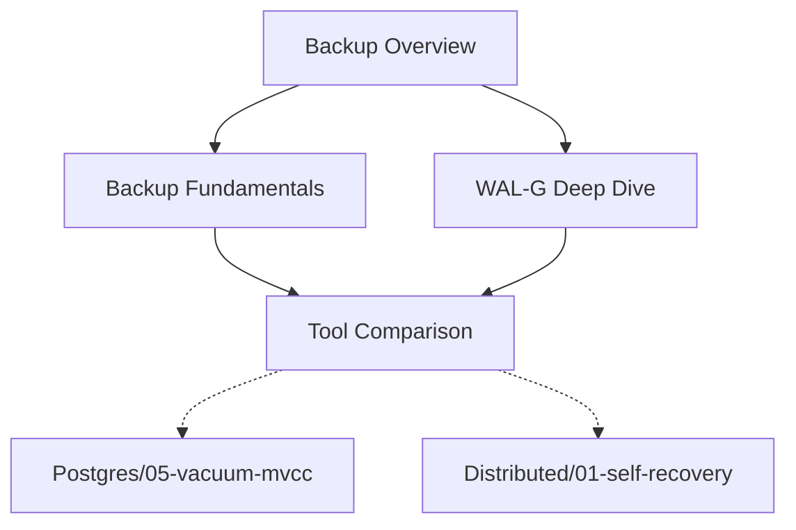

# Database Backup & Disaster Recovery — ซีรีส์การสำรองฐานข้อมูลระดับ Production

---

## 🎯 ปฐมนิเทศ (Orient)

ยินดีต้อนรับสู่ซีรีส์ **Database Backup & Disaster Recovery**— ทักษะที่แยกวิศวกรที่"แค่ deploy ได้" ออกจากวิศวกรที่"นอนหลับสบายตอนตี 3" การสำรองข้อมูลไม่ใช่แค่การรัน`pg_dump` แล้ว hope for the best — มันคือการออกแบบระบบที่รับประกันว่าข้อมูลจะไม่สูญหายแม้ disk พัง, data center ไฟไหม้, หรือคนเผลอ`DROP TABLE production.orders;`

ทุกบทเรียนถูกออกแบบตามหลักการ **Learning Loop**: ลองคิด → เข้าใจหลักการ → เปรียบเทียบ trade-off → นำไปใช้จริง ภายในเวลา 5-10 นาทีต่อบทเรียน

---

## 🗺️ แผนผังการเรียนรู้ (Roadmap)

### Path A: พื้นฐานที่ทุกคนต้องรู้ → #1

เริ่มต้นด้วยการเข้าใจประเภทของ backup, RPO/RTO, และความแตกต่างระหว่าง Logical vs Physical backup

### Path B: เจาะลึก WAL-G → #2

เข้าใจสถาปัตยกรรมของ WAL-G — ทำไมต้อง rewrite จาก Python เป็น Go, compression algorithms, parallel restore, และข้อจำกัดที่ต้องรู้

### Path C: เปรียบเทียบเครื่องมือ → #3

WAL-G, pgBackRest, Barman — แต่ละตัวเก่งด้านไหน, เหมาะกับ context แบบไหน, และ trade-off ที่คุณต้องแลก

---

## 📋 รายชื่อบทเรียนทั้งหมด (Lesson List)

| # | หัวข้อบทเรียน | ประเด็นสำคัญ (Key Takeaways) |
|:---:|---|---|
| 1 | [[01-database-backup-fundamentals\|Backup Fundamentals]] |"RPO vs RTO: ทำไมการ backup ทุก 24 ชม. อาจแปลว่าคุณยอมเสียข้อมูล 23 ชม. 59 นาที" |
| 2 | [[02-wal-g-deep-dive\|WAL-G Deep Dive]] |"จาก Python สู่ Go: WAL-G restore เร็วกว่า WAL-E 4 เท่าได้อย่างไร — และอะไรที่คุณต้องจัดการเอง" |
| 3 | [[03-backup-tool-comparison\|Backup Tool Comparison]] |"WAL-G vs pgBackRest vs Barman — ไม่มีตัวไหนดีที่สุด มีแต่ตัวที่เหมาะกับ context คุณที่สุด" |

> **อ้างอิงหลัก**:
> - [WAL-G GitHub Repository](https://github.com/wal-g/wal-g)
> - [Introducing WAL-G by Citus (2017)](https://www.citusdata.com/blog/2017/08/18/introducing-wal-g-faster-restores-for-postgres/)
> - [Crunchy Data — Introduction to Postgres Backups (2023)](https://www.crunchydata.com/blog/introduction-to-postgres-backups)
> - [PostgreSQL Backup Tools Comparison — DEV Community](https://dev.to/piteradyson/postgresql-backup-tools-comparison-databasus-wal-g-pgbackrest-and-barman-2kg)
> - [PostgreSQL Official Docs — Continuous Archiving and PITR](https://www.postgresql.org/docs/current/continuous-archiving.html)
