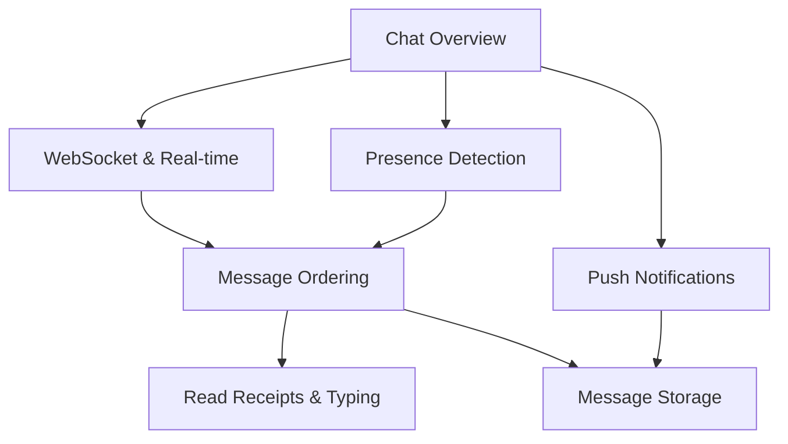

# Chat System Design — ซีรีส์การออกแบบระบบแชทระดับสูง

---

## ปฐมนิเทศ (Orient)

"การออกแบบระบบ WhatsApp / LINE / Messenger" ไม่ใช่แค่การวาดแผนภาพรับส่งข้อความ แต่มันคือโจทย์ System Design ที่คลาสสิกที่สุด เพราะมันรวมทุกมิติของ Distributed Systems ไว้ในที่เดียว: ตั้งแต่ **Real-time Connectivity**,**Data Consistency**,**Horizontal Scaling** ไปจนถึง **Efficient Storage**[source: Slack Engineering — Scaling Slack’s Real-time Messaging]

ซีรีส์นี้ประกอบด้วย **6 บทเรียนเข้มข้น** ที่กลั่นกรองจากประสบการณ์การสร้างระบบจริงจาก **สถาปัตยกรรมระบบแชท**(สถาปัตยกรรม 19 Microservices บน Google Pub/Sub, MongoDB และ Firebase) ทุกบทเรียนถูกออกแบบตามหลัก **Learning Loop** เพื่อให้คุณเข้าใจทั้ง"ทฤษฎี" และ"การนำไปใช้จริง" ภายใน 5-10 นาที

---

## 🗺️ แผนผังการเรียนรู้ (Roadmap)

### Path A: Connection Layer (การเชื่อมต่อ) → บทเรียนที่ 1, 2, 4

เจาะลึก WebSocket/SSE, Presence Detection และ Push Notifications — เรียนรู้วิธีทำให้ Server ส่งข้อมูลหา Client ได้"ทันที" ในทุกสถานการณ์แม้แอปจะปิดอยู่

### Path B: Data Layer (ชั้นข้อมูล) → บทเรียนที่ 3, 5, 6

เจาะลึก Message Ordering, Read Receipts และ Storage & Pagination — เรียนรู้วิธีรับประกันว่าข้อความจะ"ถูกต้อง ครบถ้วน และค้นหาได้" แม้ข้อมูลจะโตระดับพันล้านแถว

---

## 📋 รายชื่อบทเรียนทั้งหมด (Lesson List)

| # | หัวข้อบทเรียน | ประเด็นสำคัญในการสัมภาษณ์ (Interview Focus) |
|:---:|---|---|
| 1 | [[01-websocket-realtime\|WebSocket & Real-time]] |"WebSocket vs SSE vs Long Polling — เลือกใช้อย่างไรให้คุ้มค่า?" |
| 2 | [[02-presence-detection\|Presence Detection]] |"การออกแบบสถานะ Online/Offline สำหรับผู้ใช้ 100 ล้านคน" |
| 3 | [[03-message-ordering-delivery\|Message Ordering]] |"At-least-once vs Exactly-once — ระบบแชทควรจบที่ตรงไหน?" |
| 4 | [[04-push-notifications\|Push Notifications]] |"กลยุทธ์การส่ง Push: เมื่อไหร่ควรเตือน และเมื่อไหร่ควรเงียบ?" |
| 5 | [[05-read-receipts-typing\|Read Receipts & Typing]] |"Write Amplification: ปัญหาเบื้องหลังฟีเจอร์ 'อ่านแล้ว'" |
| 6 | [[06-chat-message-storage\|Message Storage]] |"ทำไม OFFSET ถึงใช้ไม่ได้ที่ 1 พันล้านแถว และ Cursor คือคำตอบ" |

---

## อ้างอิงจากสถาปัตยกรรมจริง

บทเรียนทั้งหมดอ้างอิงจาก **สถาปัตยกรรมระบบแชทจริง**— ระบบ Customer Support แบบ Multi-channel ที่รองรับทั้ง Facebook, LINE และ Marketplace ต่างๆ โดยมีหัวใจหลักคือ:
-  **19 Microservices** ทำงานร่วมกันผ่าน Google Cloud Pub/Sub
-**Hybrid Storage:** MongoDB (Messages), PostgreSQL (Analytics), Redis (Cache), และ Firebase (Real-time State)
-  **AI 🧠 Integration:** ระบบจัดการตั๋วอัตโนมัติด้วย Agentic AI 🧠 Engine

---

## พร้อมแล้วหรือยัง?

เริ่มบทเรียนแรกของคุณได้ที่นี่: [[01-websocket-realtime|บทที่ 1: WebSocket & Real-time Connections]]
