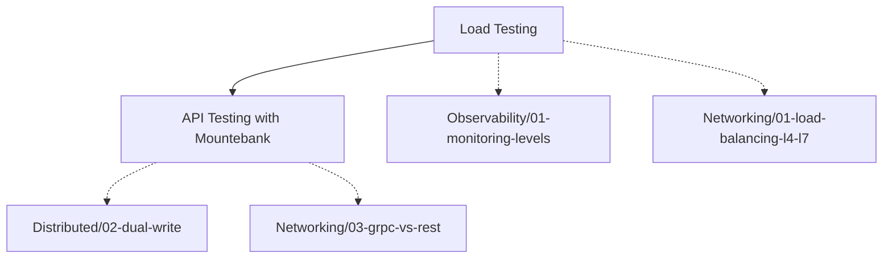

# Testing — ทดสอบก่อนที่ผู้ใช้จะทดสอบให้

> [!info] ปฐมนิเทศ
>"It works on my machine" คือประโยคที่คร่าชีวิต Production มาแล้วนับครั้งไม่ถ้วน ปัญหาไม่ใช่ว่าคุณเขียนโค้ดไม่ดี — แต่คือโค้ดของคุณไม่เคยเจอโลกจริง: API ที่ล่ม, Network Latency ที่เหวี่ยง, Load ที่ถาโถมแบบไม่ทันตั้งตัว ซีรีส์นี้จะสอนให้คุณจำลองโลกจริงใน Test Environment ด้วย **Service Virtualization (Mountebank)** และ **Load Testing **
>
> Each lesson takes **5-10 minutes **based on the **Learning Loop **principle.

## 🗺️ แผนผังการเรียนรู้ (Roadmap)

### Path A: API Testing & Service Virtualization → #1
[[01-api-testing-mountebank|API Testing with Mountebank]] — จำลอง API ของ Third-Party และ Dependency เพื่อทดสอบระบบของคุณแบบแยกส่วน โดยไม่ต้องรอให้ Dependency พร้อม

### Path B: Load Testing → #2
[[02-load-testing|Load Testing]] — กดดันระบบด้วย Traffic จริงเพื่อหาจุดแตกหัก ก่อนที่ผู้ใช้จริงจะหาเจอ

## 📋 รายชื่อบทเรียนทั้งหมด (Lesson List)

| # | บทเรียน | คำถามสัมภาษณ์ |
|---|---|---|
| 1 | [[01-api-testing-mountebank\|API Testing with Mountebank]] |"คุณจะทดสอบระบบที่ขึ้นกับ External API 3 ตัวที่ยังพัฒนาไม่เสร็จได้อย่างไร โดยไม่ใช้ if/else ในโค้ด?" |
| 2 | [[02-load-testing\|Load Testing]] |"คุณรู้ได้อย่างไรว่าระบบของคุณจะรับผู้ใช้พร้อมกัน 10,000 คนได้? แล้วคอขวดแรกที่จะพังคืออะไร?" |

> [!question] ลองทำก่อน
> คุณกำลังสร้างระบบชำระเงินที่ต้องเรียก API ของธนาคาร 3 แห่ง ทีมธนาคารบอกว่า"Sandbox จะพร้อมอีก 2 สัปดาห์" แต่ Product Manager ต้องการดู Demo วันศุกร์นี้:
> 1. คุณจะจำลอง API ของธนาคารเพื่อให้ Demo ทำงานได้อย่างไร?
> 2. หลังจากเชื่อมของจริงแล้ว คุณจะรู้ได้อย่างไรว่าระบบรับโหลดช่วง Flash Sale ไหว?
>
> หยุดคิด 30 วินาที... แล้วเริ่มเรียนบทที่ 1
